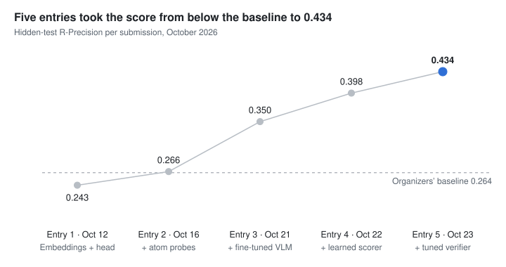
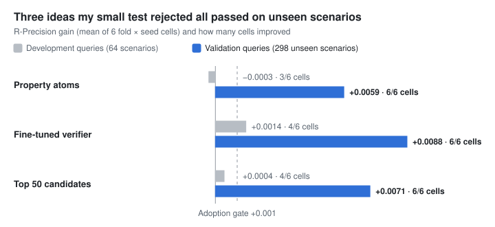

My final submission to the CASCADE causal scenario retrieval challenge scored 0.434 R-Precision and placed second on
the leaderboard, 0.011 behind first. My first submission scored 0.243, below the organizers' own baseline. I had five
submissions and used all of them. This is a write-up of what I built along the way, why I made the choices I did, and a
few things I decided not to do.

The code is at [github.com/Mister-Raggs/cascade-scenario-retrieval](https://github.com/Mister-Raggs/cascade-scenario-retrieval).

## The task

The challenge (run by NVIDIA for the NeurIPS 2026 World Models in Physical AI workshop) gives you dashcam clips, about
20 seconds each, and English descriptions of driving scenarios. For each description you rank the clips. The
descriptions are compositional. Here's one I wrote in the dataset's style:

> A signaling bus turns left while an adult pedestrian walks.

A clip only counts if all of it is there: a bus, turning left, with its signal on, and a pedestrian walking at the same
time. The hidden test set has 600+ clips and about 2,000 queries. Everything has to run inside a container you hand
over, offline, on one A100 80 GB, within six hours. You never see it run. You get a number back.

Those limits decided more of the design than I expected going in, and they come up in almost every section below.

## How the score moved



Two changes account for most of the climb. Entry 3 had a fine-tuned vision-language model answer yes/no questions about
each clip, which together with a couple of smaller additions was worth +0.084. In entries 4 and 5 I replaced my
hand-tuned way of combining signals with a learned one, and added a model that checks the whole sentence against the
top candidates. Almost all of entry 5's gain over entry 4 came on the leaderboard's Medium and Hard tiers (+0.047 and
+0.048); Easy moved by 0.011.

## Entries 1 to 3: from similarity to questions

I started with the standard approach to text-to-video retrieval: embed every clip and every query with the same model and
rank by cosine similarity. I used Qwen3-VL-Embedding-8B, frozen, with a small projection on top trained on the training
queries. It was quick to build and gave me a full pipeline I could package and submit, which mattered more at that point
than the score. It scored 0.243, under the baseline.

It wasn't hard to see why. An embedding squashes the whole sentence into one vector, so "a car turns right while a
pedestrian walks" and "a pedestrian turns right while a car walks" can end up very close together. The queries in this
dataset are mostly about exactly those details.

So instead of asking how similar a clip is to a sentence, I broke each sentence into small facts that a clip either has
or doesn't. The queries are templated, so a parser made of regular expressions was enough. I didn't use a language model
for this step because I wanted it deterministic, fast and testable line by line. For the example above it produces:

```
text   A signaling bus turns left while an adult pedestrian walks.
tree   while( agent|action=turn_left|type=bus ,  agent|action=walk|type=ped_adult )
props  agent|prop=signal|type=bus
```

I ended up with 95 of these atoms, covering other road users, traffic lights, objects like cones and signs, and the
camera car itself. Each becomes a plain question such as "Does a bus turn left at any point in this video?", and a clip's
score for a query comes from the answers to that query's atoms.

For entry 2 the answers came from small linear probes on frozen features. That was cheap, and bought +0.023. For entry 3
I had a vision-language model answer them directly: Qwen3.8-27B, fine-tuned with LoRA on clip-level labels I derived from
the dataset's annotations, looking at 16 frames per clip. Together with an ego-motion classifier and a wider parser, that
was the biggest single step of the project, +0.084 on the hidden test.

Asking 95 questions about every clip would be expensive done naively. I never let the model generate text. I read the
next-token logits once and use the gap between "yes" and "no" as the score. And since the video takes thousands of
tokens while a question takes a few dozen, I encode each video once, keep its attention cache, and run all its questions
as short batched continuations of it. An extra question then costs about as much as its own handful of tokens.

That cache sharing is easy to get subtly wrong, so every run checks it on the first clip against the full, unshared
prompt. Training through it also needed a patch: this model has linear-attention layers whose cache is updated in place,
which broke backpropagation through the shared part until I changed it.

## Entries 4 and 5: learning the combination, then checking the sentence

By entry 3 I had several signals for every query-clip pair: atom answers from the probes and from the VLM, two
embedding similarities, and whether the query parsed at all. I was combining them by hand, adding up atom
log-probabilities and blending the result with the embedding ranking at a weight I'd tuned.

For entry 4 I replaced that with a learned scorer: one linear layer over 21 features per pair (25 by entry 5), trained
with a listwise loss so it optimises the ranking within each query directly. I also tried a small MLP, and a bilinear
model that looked at the query text too. On held-out folds the linear layer improved all six fold-seed cells, by +0.014
on average. The MLP improved four of six and the bilinear model three. My first MLP scored 0.42 on the folds it trained
on and 0.235 on the ones it hadn't seen, which told me how little independent training signal I really had. I come back
to why below.

If someone rebuilt this, the detail I'd point them to is that the scorer has to be trained on VLM answers for clips that
VLM didn't train on. Trained on in-sample answers, it learns to trust them more than it should at test time. Every
feature in my scorer's training data came from a model that hadn't seen that clip.

The atoms still couldn't tell who did what, or in which order. For that I went back to the VLM and asked it about the
whole sentence ("Does this video match the following description? …") for each query's best candidates. Asking about
every pair would be 1.3 million questions on the test set, far past the time limit, so I only ask about each query's top
50, about 100,000 questions.

In entry 4 that check was zero-shot. For entry 5 I fine-tuned a separate adapter for it, and what mattered most was the
choice of negative examples. I trained it on near misses: clips where every atom in the query is present but the clip
still isn't a match, because things happen in the wrong order or to the wrong road user. Those are exactly the cases the
cheaper stage gets wrong. Checking the top 50 with the fine-tuned verifier was the largest gain in entry 5.

## The mistake that nearly cost me entry 5

The three biggest improvements in my final entry were ideas I had tested and rejected the day before.

I was careful about evaluation from the start, or thought I was. I split the labelled clips into three folds and ran each
experiment with two seeds, so every change was judged on six cells. I only adopted a change if the average went up, at
least four of the six cells improved, and no fold got worse. I wrote that rule, plus any rule specific to the
experiment, into the script before running it. I also kept a separate audit set of clips and queries that I looked at
only five times over the whole project, each time with the pass condition committed first.

What I hadn't checked was how many independent things I was testing on. I had 711 development queries, which felt like
plenty. But the dataset describes each scenario many ways, and queries with exactly the same matching clips are
paraphrases of one another. My 711 queries were 64 scenarios, about 11 phrasings each.

On October 22 that test rejected three ideas. One was asking separate questions about the qualifiers my atoms ignored:
signaling, slow, double-parked, flashing lights. Another was fine-tuning the sentence verifier instead of using it
zero-shot. The third was verifying the top 50 candidates rather than the top 30. The fine-tuned verifier, for instance,
failed only because one fold dropped by 0.003.

The next day I moved my main test to the official validation queries. There are 3,108 of them, labelled over the same
clips and covering 298 scenarios, and I had never trained on them or measured with them. I split the scenarios into two
halves and always tested on the half the scorer hadn't been trained on. All three rejected ideas passed, on all six
cells.



Same ideas and same rule. Only the test changed.

After the challenge I measured how bad the problem was. Within a scenario, per-query scores correlate at about 0.95: a
query's paraphrases mostly repeat its result. So 3,108 validation queries carry about as much information as 300
independent ones. When comparing two systems the paraphrases are a little less redundant, but treating them as
independent still understates the uncertainty about three times. And with 64 scenarios, the smallest gain my
development test could reliably detect was about 0.023 R-Precision. Every component gain in my final entry was between
0.005 and 0.017. My careful protocol had been asking a question its test couldn't answer.

It worked in the other direction too. An ensemble with a second VLM (Qwen3-VL-30B) had looked good on the development
queries and did nothing on validation, so I dropped it.

To decide what was worth building at all, I leaned on headroom checks: swap one component's output for the ground truth
and see how far the score moves. They run on a CPU in minutes. Two of them shaped entry 5. Even with perfect atom answers,
the score reaches only about 0.64 on development queries and 0.41 on validation queries. So the atoms themselves were
losing information, and the gains had to come from the qualifiers and the sentence verifier rather than from better
atoms. The other check said a verifier that separated good candidates from bad ones better, going from an AUC of 0.69 to
0.86, would be worth about +0.05.

The part I'm least proud of is that I had a warning on October 12. Even then, the validation queries preferred a
different scoring recipe than the development queries did. I wrote it down and didn't follow it up for ten days.

## Getting it to run in their box

Whatever scored well in my experiments still had to run correctly inside a container I'd never see executed, and a
broken run scores zero. Roughly a third of my time went here.

The first problem I didn't know existed until I hit it. Submissions are uploaded as container layers to a model
repository, and on October 21 the portal rejected my third entry because the repository was too big. The limit isn't
documented anywhere, and old revisions count toward it. I squashed the history and deleted the files only older entries
used, which got the repository down to 63 GB. That was rejected too. What got through was making the model itself
smaller.

The 27B model is 55.6 GB in bf16. I removed weights that inference never touches. I cut the output layer down to the rows
for the yes and no tokens, the only part my score reads, so that step loses nothing. Then I stored the language model's
weight matrices as int8 with one scale per row, converted back to bf16 when the model loads. That brought the model to
27.9 GB and the repository to about 44 GB, which was accepted. On a held-out fold it cost 0.002 R-Precision. I didn't try
anything cleverer: this was enough, and it needed no calibration data or custom kernels.

Then there's the question of whether the container actually runs the system I evaluated. All my results came from
research code, and the container runs a separately packaged version of it. Before every upload I ran the container
offline on clips with unfamiliar ids, with no network, read-only inputs, label files deliberately corrupted so any
accidental read would show up, and the GPU capped at 80 GB. Its features had to match the research code's, and its
top-ten rankings had to match exactly on 64 of 64 queries.

Timing was the last risk. I developed on an H200, which is a lot faster than the organizers' A100, so I rented an A100
80 GB and ran the final package at roughly test scale through the same layer-loading tool they use:

| Stage on an A100, 650 clips × 2,000 queries | Entry 4 | Final entry |
| --- | --- | --- |
| Embedding and motion features | 44 min | 30 min |
| Atom and property questions | 28 min | 48 min |
| Whole-sentence verifier | 29 min | 50 min |
| **Total** | **1h48m** | **2h14m** |

The evaluator had reported 3 to 3.5 hours for entry 4, so by the same ratio I expected entry 5 to take 3.7 to 4.3 hours
of the six. I added a time guard anyway. If the atom questions look like they'll run past three hours, the remaining
clips drop from 32 frames to 16. At 4 hours 15 minutes the sentence verifier stops, and any query it hasn't reached gets
neutral values. I forced both fallbacks in a test run to make sure every query still gets ranked. The real run needed
neither.

Having measured the time budget is what let me afford 32 frames and 50 candidates in the final entry at all.

## What I tried that didn't work

Most of what I tried failed, and I closed each one with a rule I'd set before seeing the result. A few are worth
describing.

I fine-tuned two other VLMs the same way as Qwen3.8, in pilots on one fold: Cosmos-Reason2-32B and Gemma 4 31B. Cosmos
matched or slightly beat Qwen3.8 at answering individual atom questions, and still ranked clips worse, by 0.025. Gemma
lost by 0.007. Higher resolution (448×800) did the same thing on a smaller scale: slightly better answers, no better ranking. I
don't have a full explanation, but it made me stop treating per-question accuracy as a proxy for the score.

More frames helped up to a point. 32 frames beat 16 for the atom questions, but 64 frames made the verifier worse and ran
into the model's context limit. Fine-tuning the embedding model with LoRA overfit badly (−0.03); a fold had only about
570 training queries. Flipping videos left to right and swapping "left" and "right" in the text, as augmentation, made
things slightly worse. Gradient-boosted scorers swung too much from fold to fold to trust.

Some ideas I closed before building them. Using agreement between paraphrases of the same query looked promising until a
headroom check showed that even a perfect version would add almost nothing. Perfect knowledge of when each event happens
was worth only +0.005, too little to justify separate perception for each time window.

After entry 5's recipe was fixed, I tried one last scale-up of the verifier, with more training data and longer training.
It came out −0.003 on unseen scenarios, and that's where I stopped.

## What I chose not to do

Some of the decisions that mattered were about holding back.

I didn't use submissions to test things. Every entry was something I'd already confirmed on my own audit set. After the
first one I made a rule not to spend an entry on a weight tweak or on debugging compatibility.

I didn't look at the audit set whenever I felt like it. Five looks in total, each with the pass condition committed
beforehand. It's tedious, but it's why I trusted my estimate for the final entry: I projected 0.42 to 0.45, and it
scored 0.434.

I didn't ship the variant with the best validation number. Training the atom adapter for twice as long gained +0.008 on
validation queries but lost 0.025 on development queries. On the last entry, with no second chance, I wasn't willing to
take a trade-off I couldn't explain.

I wouldn't have shipped Cosmos-Reason2 even if it had won. It's under NVIDIA's Open Model License, the challenge wants the
final submission under Apache-2.0, and I'd have needed the organizers to confirm the two were compatible.

I didn't push the runtime toward the six-hour limit. A slower entry that scores better on paper is worth nothing if it
times out.

And I didn't write about any of this while the leaderboard was open.

## If I started again

I'd count scenarios before trusting any test, and I'd use the validation queries from day one. I'd run headroom checks
before building anything big, because they're cheap and they pointed me in the right direction more reliably than my
intuition did. And I'd treat the runtime and size limits as part of the design from the start, rather than something to
deal with at packaging time. The size limit alone cost me several rejected uploads.

## A note on how I built this

I built this with an AI coding agent doing most of the implementation. It wrote the code, ran experiments on rented
cloud GPUs, and kept a dated log of every result. I decided what to try, when to stop, and what to submit, and it
couldn't upload or submit anything without my explicit OK for that exact package.

It was most useful for the dull discipline that's easy for a person to skip: writing the pass rule into each script
before running it, recording the failed and broken runs next to the good ones, and checking the container against the
research code. It didn't save me from the scenario mistake, though. We both missed that for ten days.
